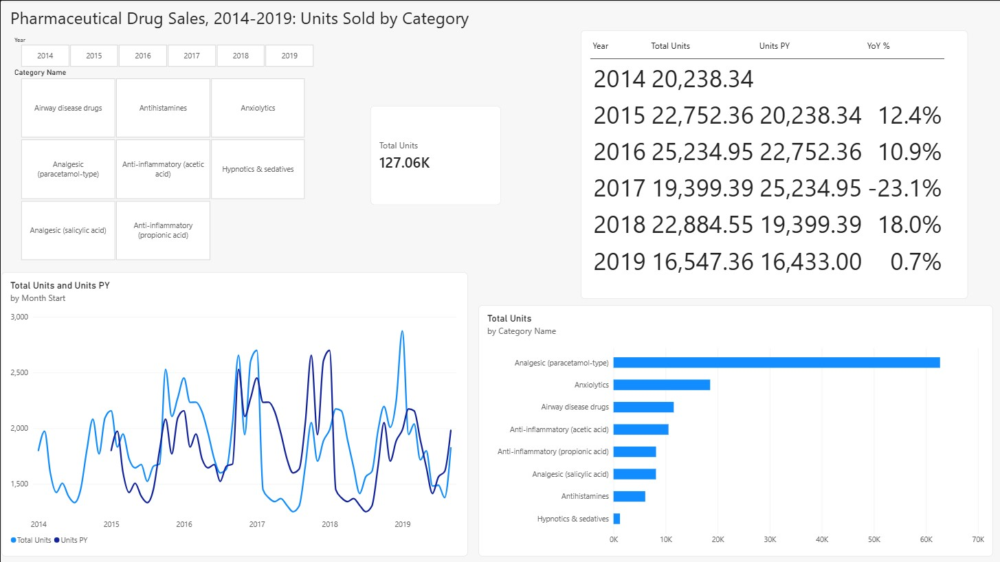
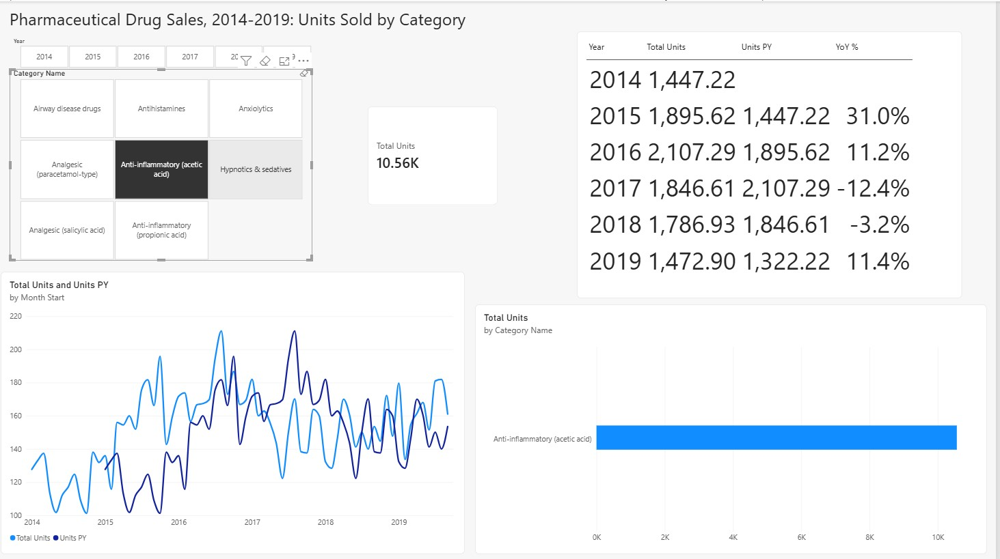

# Pharmaceutical Drug Sales Analysis (Excel + Power BI)

An end-to-end analysis of pharmacy sales volume, 2014-2019, using Python (pandas) for cleaning, Excel for structuring and pivoting the data, and Power BI for an interactive report with DAX year-over-year measures.


## Problem statement

A pharmacy wants to know **which drug categories drive sales volume, how demand moves over time, and whether volume is growing**. The data has quirks (an incomplete final year, a monthly file that disagrees with the daily file), so part of the task is making the year-over-year comparison *fair* rather than just computing it.

Questions answered:
1. Which drug categories account for most units sold?
2. How does monthly volume trend across 2014-2019?
3. How does each year compare with the previous year, like for like?

## Data

- **Source:** Kaggle, [Pharma sales data](https://www.kaggle.com/datasets/milanzdravkovic/pharma-sales-data) by Milan Zdravkovic. Check the dataset page for its license terms. The raw files are **not** included in this repo; download them from Kaggle.
- **What it contains:** units sold per **ATC drug category** (8 categories), 2 Jan 2014 to 8 Oct 2019, at hourly / daily / weekly / monthly granularity. Per third-party descriptions, the underlying raw data is ~600K transactions from a single pharmacy aggregated to 57 drugs and then 8 ATC categories; only the 8-category roll-up is in the download.
- **Measure:** *units sold* (quantities), **not revenue**. There is no price column.
- `data/pharma_sales_powerbi.csv` is the cleaned file used for Power BI (552 rows = 69 complete months x 8 categories).

## Data cleaning and quality findings (pandas)

Script: [`scripts/clean_and_aggregate.py`](scripts/clean_and_aggregate.py) (reproduces the CSV from the raw Kaggle files and prints the checks below).

| Check | Result | What I did |
|---|---|---|
| Nulls / duplicate dates / missing days | None | Nothing needed |
| Hourly vs daily files | Reconcile exactly | Daily file used as source of truth |
| Monthly file vs daily roll-up | Differs by >1% in 28 of 70 months (Jan 2017 is ~0 in the monthly file but ~2,700 units in the daily data) | **Ignored `salesmonthly.csv`**; rebuilt monthly totals from daily data |
| Last month (Oct 2019) | Data ends 8 Oct, so partial | Dropped from the Power BI file; flagged in Excel |
| Year-over-year for 2019 | 2019 is incomplete | Compared **Jan-Sep 2019 vs Jan-Sep 2018** only |
| Days with zero sales in every category | 26 scattered days | Kept as-is (cause unknown: closures or gaps) |
| Daily `Hour` column | Constant/meaningless | Dropped |

## Excel workbook

File: [`excel/pharma_sales_analysis.xlsx`](excel/pharma_sales_analysis.xlsx)

- Formatted Excel Table (`tblSales`, 560 rows: month x category).
- Lookups mapping category codes to names and ATC main groups: **VLOOKUP** and **INDEX/MATCH** (a code-to-name lookup table is on the `Lookup` sheet).
- `Analysis` sheet with SUMIFS / LARGE / INDEX-MATCH formulas feeding 4 charts: monthly trend, category share, top 5 categories, Jan-Sep units by year.
- A native **PivotTable** (ATC group > category by year, with partial months filtered out).
- A `Notes` sheet documenting assumptions.


## Power BI report

File: [`powerbi/pharma_sales_dashboard.pbix`](powerbi/pharma_sales_dashboard.pbix)

**Model:** `Sales` table (the CSV) related to a `Calendar` table (`Calendar[Date]` one-to-many `Sales[Month]`, single direction), marked as a date table. Month dates are the 1st of each month so that same-period-last-year works in leap years.

**DAX measures**

```DAX
Total Units = SUM ( Sales[Units Sold] )

Units PY = CALCULATE ( [Total Units], SAMEPERIODLASTYEAR ( 'Calendar'[Date] ) )

YoY % = DIVIDE ( [Total Units] - [Units PY], [Units PY] )
```

The calendar table ends at the last complete month (30 Sep 2019), so 2019 is compared with the same Jan-Sep window in 2018.

**Page contents:** year slicer, category slicer, total-units card, yearly table (units, prior-year units, YoY %), monthly line chart (this year vs prior year), and a category bar chart.

<!-- TODO: add your screenshots, saved with these file names -->



## Insights

1. **One category dominates volume.** Paracetamol-type analgesics make up about 49% of all units (62,710 of 127,057). Together with anxiolytics they account for about 64%, and the Nervous system group as a whole is about 71%.
2. **Demand grew, dipped, then recovered.** Yearly volume rose from 20,238 units in 2014 to 25,235 in 2016 (+12.4% in 2015, +10.9% in 2016), fell 23.1% in 2017, then rebounded 18.0% in 2018. The data does not explain the 2017 drop, so it would be worth asking the business whether it reflects closures, stock issues or a data gap.
3. **2019 is roughly flat, not falling.** On a like-for-like Jan-Sep basis, 2019 is +0.7% versus 2018 (16,547 vs 16,433 units). Comparing the incomplete 2019 against full-year 2018 would wrongly show a drop of about a quarter.
4. **Categories do not move in step.** In 2018 total volume rose 18.0% while Anti-inflammatory (acetic acid) fell 3.2%; in Jan-Sep 2019 that category rose 11.4% while the total was +0.7%. Planning stock from the total alone would hide these differences.

## Limitations

- Units sold, not revenue or profit; one pharmacy; no product-level detail in the download.
- 2019 covers Jan to 8 Oct only.
- Causes of the 2017 dip and the 26 zero-sales days are unknown from the data.
- Category names are short labels based on the ATC classification and should be checked against the WHO ATC index.
- No forecasting; this is descriptive analysis.

## How to reproduce

```bash
pip install -r requirements.txt
python scripts/clean_and_aggregate.py --input-dir path/to/kaggle_csvs --output-dir data
```

Then open `excel/pharma_sales_analysis.xlsx`, and load `data/pharma_sales_powerbi.csv` into Power BI Desktop (see the model and measures above).

## Tools

Python (pandas), Excel (Tables, VLOOKUP, INDEX/MATCH, SUMIFS, PivotTable, charts), Power BI Desktop (data model, DAX, slicers).
